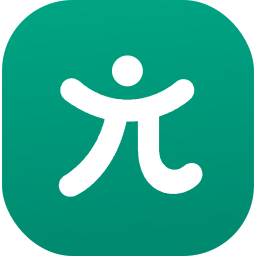
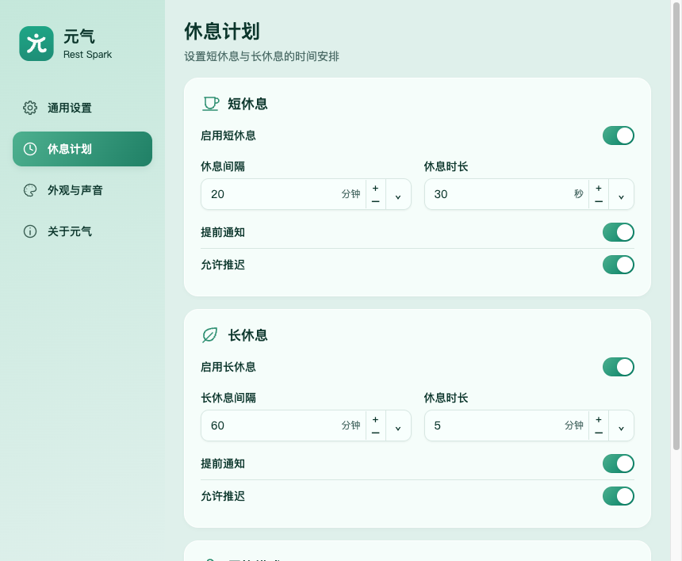
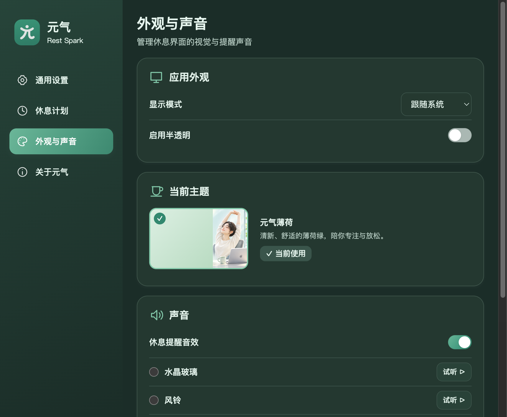

<div align="center">



# 元气 · Rest Spark

**休息一下，恢复元气。**

一款为 Mac 打造的轻量休息提醒工具。用舒适的薄荷绿界面，帮你在专注工作与适时休息之间找到节奏。

*A refreshing break reminder for macOS. Work with focus, rest with care.*

[**下载最新版本 / Download**](https://github.com/DeepCarry/RestSpark/releases/latest) · [**查看截图 / Screenshots**](#界面预览--screenshots) · [**English**](#english) · [**支持项目 / Support**](https://deepcarry.io/zh/origin#support)

</div>

## 为什么选择元气？

长时间面对电脑，容易忘记起身、活动和放松。**元气（Rest Spark）** 在你工作时安静地待在菜单栏，到合适的时间温柔提醒你休息，让短暂的停顿成为可持续的日常习惯。

### 主要功能

- **短休息 + 长休息**：分别设置提醒间隔与休息时长，支持预设值和自定义时间。
- **薄荷绿双主题**：浅色「元气薄荷」、深色「元气夜绿」，也可跟随 macOS 系统外观自动切换。
- **灵活的提醒方式**：支持提前通知、推迟或跳过休息，以及严格模式。
- **智能适应工作状态**：沿用空闲检测、勿扰模式监测等能力，尽量减少不合时宜的打扰（具体表现依系统环境而定）。
- **熟悉的 macOS 体验**：常驻菜单栏，提供中文与英文界面，可调整声音、提醒行为及其他偏好。

### 快捷操作

- 左键点菜单栏图标可立即休息，或暂停 1、2、3、5 小时及至次日早晨。暂停期限在重启后保留。
- 新用户可用两步引导选择休息节奏。已有用户可从「通用设置 → 新手引导 → 查看引导」预览，原有设置保留。
- 系统勿扰状态不可读时，面板会明确提示。会议或演示时可使用定时暂停。

[PRD v1.1 开发与验证记录](docs/rest-spark/prd-v1.1/DELIVERY.md)

## 界面预览 / Screenshots

以下为项目实际运行与界面验收截图，展示休息提醒、休息计划及外观设置。

<table>
<tr>
<td width="50%" align="center"><br><strong>短休息 · 浅色主题</strong><br>Mini break · Light</td>
<td width="50%" align="center"><br><strong>长休息 · 深色主题</strong><br>Long break · Dark</td>
</tr>
<tr>
<td align="center"><br><strong>休息计划</strong><br>Break schedule</td>
<td align="center"><br><strong>外观与声音</strong><br>Appearance & sounds</td>
</tr>
</table>

## 下载与安装

**当前版本：v0.2.0** · [发布说明](https://github.com/DeepCarry/RestSpark/releases/tag/v0.2.0)

**系统要求**：macOS 12 Monterey 或更新版本，Apple 芯片（M 系列）。

1. [下载 macOS 安装包（DMG）](https://github.com/DeepCarry/RestSpark/releases/download/v0.2.0/Rest-Spark-0.2.0-mac-arm64.dmg)。
2. 打开 DMG，将 `Rest Spark.app` 拖入「应用程序」文件夹。
3. 从「应用程序」启动「元气」，按需调整休息计划与主题。

> v0.2.0 提供 Apple Silicon macOS DMG 和 Windows x64 EXE。该构建采用 ad-hoc 签名，尚未经过 Apple 公证。如果 macOS 拦截首次打开，请先确认文件来自本仓库、核对 [SHA-256 校验文件](https://github.com/DeepCarry/RestSpark/releases/download/v0.2.0/SHA256SUMS.txt)，再按照 [Apple 官方说明](https://support.apple.com/zh-cn/102445) 在「系统设置 → 隐私与安全性」允许打开。

后续版本请以 [Releases](https://github.com/DeepCarry/RestSpark/releases) 页面实际提供的安装包为准。

## English

**Rest Spark (元气)** is a mint-green break reminder for macOS. It lives in the menu bar and helps you build healthier work-and-rest routines without losing your focus.

**Highlights:** independent mini-break and long-break schedules; customizable intervals and durations; light, dark, and system-following themes; advance notifications, postponement, skipping, strict mode, and idle/Do Not Disturb awareness.

**Download:** [GitHub Releases](https://github.com/DeepCarry/RestSpark/releases/latest). Version **0.2.0** currently provides a DMG for **Apple Silicon Macs running macOS 12 or later**. Drag `Rest Spark.app` to Applications. The build is ad-hoc signed and not Apple-notarized; see the [release notes](https://github.com/DeepCarry/RestSpark/releases/tag/v0.2.0) for first-launch guidance and checksum verification.

**Feedback:** [Report an issue or suggest an improvement](https://github.com/DeepCarry/RestSpark/issues).

## 参与开发 / Development

欢迎反馈问题、建议改进或贡献代码：[Issues](https://github.com/DeepCarry/RestSpark/issues)。

本项目采用 Electron。开发环境建议使用 Node.js 24：

```bash
git clone https://github.com/DeepCarry/RestSpark.git
cd RestSpark
npm ci
npm start
```

```bash
npm test
npm run lint
```

相关实现记录：[主题外观](docs/rest-spark/appearance.md) · [休息计划](docs/rest-spark/settings-v3/DELIVERY.md)。

## 支持项目 / Support

元气由 **[DeepCarry](https://deepcarry.io)** 独立维护。你的支持可以帮助 DeepCarry 持续开发开源工具、修复问题并改进体验。

**[💚 前往 DeepCarry 官网赞助 / Support DeepCarry](https://deepcarry.io/zh/origin#support)**

官网提供 **BTC、ETH（EVM）和 SOL** 的加密货币赞助入口。转账前请在官网核对钱包地址及对应网络。

## 开源协议 / License

本项目代码基于 [BSD-2-Clause](LICENSE) 许可证发布。相关版权声明及免责条款以仓库中的 [LICENSE](LICENSE) 文件为准。品牌名称与图形的独立使用授权请以维护者发布的条款为准。

## 致谢 / Credits

**元气 / Rest Spark** 基于 **[Stretchly](https://github.com/hovancik/stretchly)** 进行二次开发，并由 DeepCarry 以独立项目持续维护。

衷心感谢 **[Jan Hovancik](https://github.com/hovancik)** 创建 Stretchly，以及所有上游贡献者的长期投入。原项目的 BSD-2-Clause 版权声明予以保留：**Copyright (c) 2016-, Jan Hovancik**。

*Built on Stretchly by Jan Hovancik and its contributors. Thank you for making better break habits possible.*
