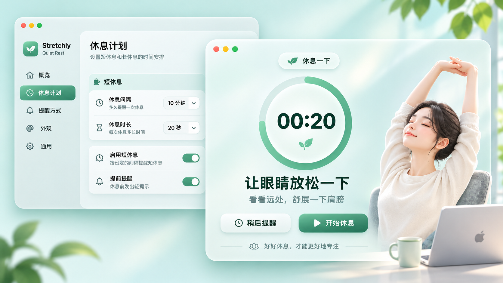

# Stretchly · Quiet Rest — Codex 开发交接文档

> **交接日期：** 2026-11-09（北京时间）  
> **讨论日期：** 2026-11-08（北京时间）  
> **原聊天标题：** 未提供  
> **项目仓库：** https://github.com/DeepCarry/stretchly  
> **任务状态：** 高保真主视觉已确认；待进入代码实现及运行验收  
> **工程目标：** 在现有 Electron 版 Stretchly 上完成第一阶段 UI 重设计，优先实现**短休息提醒、长休息提醒、休息计划设置**，保留既有休息提醒功能。

## 0. Codex 请先阅读

本交接包包含：

- `README.md`：需求、实现顺序与验收标准。
- `assets/approved-ui-master.png`：**用户明确选定的唯一正式视觉母版**。请以它为设计基准；其他在聊天中生成的效果图仅供探索，不具有同等优先级。

**视觉优先级：** 用户确认的母版图片 > 本文的视觉约束 > 其他概念草图。所有控件、文字、计时进度都需要开发为真实、可交互的界面元素。母版是静态效果图，**不得将整张截图直接作为程序背景来伪装成可用界面**。



## 1. 背景与用户明确表达的决定

1. 用户 Fork 了开源休息提醒项目 `DeepCarry/stretchly`。原软件功能基本满足需求，包括工作间隔、短休息、长休息、提醒与设置；主要问题是 **UI 视觉品质欠佳**。
2. 用户希望呈现与 macOS 相匹配的**精致、自然、温柔、现代**的视觉体验。设计方向采用「**Stretchly · Quiet Rest**」：薄荷绿 + 柔和玻璃拟态 + 高级简洁感。
3. 用户在 2026-11-08 17:34 左右**明确将上方图片定为定稿**。图中女孩形象、发型、颈肩比例、姿势和构图以该图片为准。此后对其他图片的尝试均不得覆盖这个确认。
4. 用户对先前几版人物的**脖子过长、过细**反复提出修改意见；新增耳机后也出现比例失衡。**最终选中的母版里人物没有耳机**，因此 V1.0 应保持无耳机版，勿自行加回耳机或重新生成人物。
5. 用户要求补齐其他 UI，并同意按先实现**短休息、长休息、休息计划设置**，之后再逐步完善其余界面的顺序推进。

## 2. 已确定的设计规范

### 2.1 视觉语言

- **总体风格：** macOS 风格的轻盈窗口；浅薄荷色、米白、柔和渐变、半透明玻璃质感、柔和阴影、圆角卡片，克制的绿色强调色。
- **排版：** 大号清晰倒计时、中文标题、较低对比度说明文字，形成明晰的信息层级；优先系统字体栈和可访问字号。
- **短休息倒计时：** 大号圆环进度、中央动态 `00:20` 示例、休息提示及真实操作按钮。圆环随状态实时变化。
- **设置界面：** 左侧导航与右侧分组卡片；短休息间隔/时长、启用短休息、提前提醒为核心可见项，并完整保留其余现有配置入口。
- **图形语言：** 叶片/嫩芽图标、淡绿色几何/植物背景；图标风格与间距统一，避免堆砌装饰。
- **浅色/深色：** 建立复用的主题变量；深色外观应对齐相同布局和控件体系。
- **品牌：** 暂以 `Stretchly · Quiet Rest` 作为设计稿副标题/视觉方向，是否正式更改 App 名称、安装包名和 bundle ID **尚未由用户确认**，不要直接修改。

### 2.2 人物与资产——严格锁定

- **唯一参考：** `assets/approved-ui-master.png` 的右侧休息窗口。人物深色低盘发，穿米白上衣，闭眼微笑，双手上举伸展，颈肩自然，旁边有电脑、马克杯和绿植。
- **不要：** 增加耳机；拉长/缩细脖子；放大发髻；更换人物、画风、五官或整体构图。
- **实现方式：** 静态人物/风景可以使用来源于正式母版的合规裁切或独立素材，动态计时器、按钮、文案、状态必须用 HTML/CSS/JS 原生绘制；在无法可靠分离人物素材时，先保持界面结构与视觉风格一致，明确记录资产不足，不自行生成不一致的新人物。
- 母版展示两窗口相互叠放是**产品展示构图**；实际运行时应按 Stretchly 现有逻辑分别打开提醒窗口和设置窗口，无须模拟两窗总是同时重叠。

## 3. V1.0 开发范围

### P0：必须完成

1. **短休息提醒（Mini/Microbreak）**：保持动态倒计时、环形进度、休息文案、推迟/跳过/结束状态；兼容用户配置的通知及严格模式。
2. **长休息提醒（Long Break）**：沿用同一设计系统，展示更长时长（母版以 05:00 为示例），保持长休息原有行为和独立配置；允许使用自然场景背景，但优先保证与母版的风格统一。
3. **休息计划设置**：以左侧导航 + 右侧分组卡片重构短休息、长休息间隔和时长，以及提前提醒、开关、推迟和严格模式等已有功能的设置体验。
4. **设计基础设施**：抽取主题色、文本层级、间距、圆角、阴影、按钮、卡片、开关、进度环等可复用样式；处理中英文与深浅色适配。

### P1：P0 验收后再做

- 其他设置项（提醒方式、外观、通用设置）的统一视觉。
- 菜单栏图标与已有原生菜单的视觉细化。
- 欢迎/首次启动界面；深色模式细节与更多屏幕尺寸。

### 不属于当前 V1.0 的功能

账号/登录、订阅 Pro、云同步、个人资料、站内反馈系统、全新统计仪表盘、云端数据服务等。这些曾出现在**AI 生成的探索性效果图**里，用户没有将其确认为新功能需求。菜单栏全新自定义弹出面板同样留待后续评估。

## 4. 功能兼容要求（不得回归）

- 保留原有短休息/长休息**定时调度**、持续时间与间隔配置；默认示例仅用于展示，实际以配置为准。
- 保留**推迟、跳过、手动结束、严格模式**的条件与状态逻辑；不要给严格模式添加越权的跳过按钮。
- 保留提前通知、声音、空闲检测（natural breaks）、勿扰模式、全屏、多显示器、语言、本地配置持久化等已有能力。
- 保留快捷键、可访问名称、键盘操作、长文案布局；并检验窗口变窄、不同 DPI 和深色环境的布局。
- **按钮语义特别注意：** 设计稿的“开始休息”属于视觉示意；Stretchly 现有提醒窗口可能在休息已启动后才出现。应根据真实生命周期决定按钮文案/行为，避免错误重启休息倒计时。可用“稍后提醒/跳过本次”等真实状态动作替换示意 CTA。
- 不引入不必要的联网功能；保留现有 CSP、HTML 净化和 Electron preload/renderer 安全边界。

## 5. 源码入口（已在对话中检查；实施前再验证当前分支）

仓库 `package.json` 在此前检查时标记为 `1.20.0`，使用 Electron + HTML/CSS/JS；请以开始工作时实际检出的仓库为准。

| 目标 | 关键文件 |
| --- | --- |
| 短休息 HTML | `app/microbreak.html` |
| 长休息 HTML | `app/break.html` |
| 休息样式 | `app/css/break.css` |
| 设置窗口结构 | `app/preferences.html` |
| 设置样式 | `app/css/preferences.css` |
| 公共控件样式 | `app/css/commons.css` |
| 主题颜色 | `app/css/color-scheme.css` |
| 提醒状态、倒计时与交互 | `app/microbreak-renderer.js`, `app/break-renderer.js` |
| 设置值绑定 | `app/preferences-renderer.js` |
| 窗口行为、调度与配置 | `app/main.js` 及相关模块（优先维持现状） |

重要：现有 renderer 通过 CSS 类名、`id`、`window.breaks` 与 `window.settings` 绑定状态。变更 DOM 结构时同步核对所有选择器与事件注册，避免纯视觉调整破坏业务逻辑。短/长休息均使用 HTML `<progress>` 和剩余时间元素，可以在保留数据绑定的基础上替换展示外观。

## 6. 开发执行顺序

1. **检查代码与分支。** 从 `trunk` 创建 `feature/quiet-rest-ui`（若已存在则先检查），确认工作区无未提交修改；保留用户现有本地变更。先阅读 `README`、`package.json`、相关 HTML/CSS/renderers 和现有测试。
2. **保留原版截图。** 在实际 macOS 环境运行现有版本，记录短休息、长休息、休息计划设置的原始截图和状态行为。
3. **制定最小范围改造。** 把颜色、字体、间距、圆角、阴影抽成可复用变量；优先沿用现有 Electron，避免引入全新的 UI 框架/构建系统。
4. **实现提醒窗口。** 先完成短休息，再复用组件/样式实现长休息；计时器应有实时进度及正确剩余时间，图片素材与文字层分离。
5. **实现休息计划设置。** 保留原设置项、取值范围、持久化和语言支持；调整为更易扫描的左侧导航与设置卡片。
6. **功能回归与视觉对照。** 在 macOS 运行，和 `approved-ui-master.png` 对照人物、主色、圆环、控件和空间比例；测试各种状态、窗口大小与深浅色。
7. **交付代码与证据。** 提交到功能分支，提供差异摘要、截图、测试结果和 PR（如具备权限）；**不要未经确认合并 `trunk`**。

建议验证命令（以当前 `package.json` 为准）：

```bash
npm ci
npm start
npm test
npm run lint
npm run pack
```

如果自动化工具无法真正启动 macOS 桌面窗口或抓取截图，准确说明限制、保留未完成检查项，不得声称已完成视觉验收。

## 7. 验收标准（Definition of Done）

- [ ] 可以在 macOS 启动经过改造的 Electron App。
- [ ] 交付短休息、长休息和休息计划**三个可操作的真实页面**，不是纯图片展示。
- [ ] 主要视觉与用户定稿母版一致：浅薄荷绿、柔和玻璃卡片、倒计时圆环、统一控件；人物保持母版无耳机及自然颈肩比例。
- [ ] 开始前通知、倒计时变化、休息完成、推迟、跳过、严格模式、设置持久化行为保持正确。
- [ ] 中文和至少英文界面无明显文本溢出，支持键盘焦点和可读对比度。
- [ ] 浅/深色与常用窗口尺寸可用。
- [ ] 执行项目支持的测试、lint 和打包检查；对失败项逐项列出原因。
- [ ] 提供修改文件清单、前后截图、测试报告、运行步骤、待办事项与分支/PR 链接（若创建）。

> **重要的范围控制：** 视觉一致性以母版图片为准，业务行为以现有代码和用户实际设置为准。遇到两者冲突时，优先保持正确的休息提醒功能，并在交付说明中注明视觉改动理由。

## 8. 可直接粘贴给 Codex 的执行指令

请打开 `https://github.com/DeepCarry/stretchly` 对应的本地仓库，并先阅读本交接包的 `README.md` 和 `assets/approved-ui-master.png`。严格以图中**无耳机人物的那版**为唯一视觉定稿，从 `trunk` 新建 `feature/quiet-rest-ui`，逐步实施短休息提醒、长休息提醒、休息计划设置及必要的样式基础设施，最大程度保留现有 Electron 架构和全部休息提醒功能。请先检查代码依赖、列出简短实施计划，然后直接实施、运行检查、测试和截图验收；若不能运行 macOS GUI，明确标注未验证项。避免添加登录、Pro 订阅、云同步、统计仪表盘等探索性功能。最后提交功能分支并报告改动、测试、截图、运行方法及后续建议；未经确认不要合并 `trunk`。
